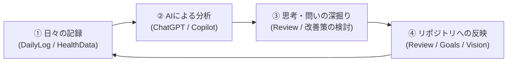

# Personal Knowledge Base

思考・行動・価値観を蓄積し、AIと共に自己理解と改善を継続するためのパーソナルナレッジベース（Second Brain）です。  
日々の記録（Raw Data）をMarkdown形式でGit管理し、ChatGPTやGitHub MobileなどのAIパートナーから横断的に参照・分析できる環境を構築しています。

---

## 🎯 目的とコンセプト

1. **自己理解の深化**  
   日々の出来事、感情、行動ログを蓄積し、自分自身でも気づいていない思考・行動の傾向やパターンをAIと共に発見・分析します。
2. **価値観と目標の整合**  
   自身の価値観（Vision）や長期目標（Goals）に立ち返り、日々の行動やタスクがそこに沿っているかを定期的に振り返ります（Review）。
3. **AIパートナーとの共創**  
   AIを「単なる相談相手」にとどめず、過去の記録を踏まえた「理解者」「分析者」「問いかけ役」「改善パートナー」として位置づけ、内省と行動改善のサイクルを回します。
4. **スマホからのシームレスなアクセス**  
   GitHub Privateリポジトリとして運用し、外出先やスキマ時間でもスマホ（ChatGPT / GitHub Mobile）から記録の参照・追加が行えます。

---

## 📁 フォルダ構成と役割

リポジトリ内のデータは、情報の性質（事実、理解・戦略、行動、記録）に応じて以下のフォルダに分類されています。

```text
Personal/
├── README.md                # 本ファイル（概要と運用方針）
│
├── 00_Vision/               # 人生の価値観、理想の生活・働き方、行動原則
├── 10_Goals/                # 長期・中期目標、年間目標
├── 20_Projects/             # 進行中および計画中のプロジェクト
├── 30_Tasks/                # タスク管理（直近のやること、週間タスクなど）
├── 40_DailyLog/             # 日々の記録（年別フォルダ：行動、感情、メモ、音声記録など）
│   └── 2026/
├── 50_Review/               # 週次・月次の振り返り、行動傾向分析、AIとの改善履歴
├── 60_learning/             # 学びの記録、読書メモ、スキルアップのナレッジ
└── 70_HealthData/           # ライフログ・健康データ
    ├── Garmin_activity/     # ランニングなどのアクティビティログ
    └── Garmin_health/       # 睡眠、HRV、ストレスなどのヘルスケアデータ
```

### 各ディレクトリの詳細

| フォルダ | 分類 | 主な格納内容 |
| :--- | :--- | :--- |
| **`00_Vision/`** | Vision | 自身の根底にある価値観（Values）、理想の生き方（Ideal Life）、働き方（Ideal Work）、行動指針（Principles） |
| **`10_Goals/`** | Strategy | 長期ビジョン、中期目標、各年の目標（2026.md 等） |
| **`20_Projects/`** | Action | 目標達成のための具体的プロジェクト計画・進捗 |
| **`30_Tasks/`** | Action | 日常やプロジェクトに紐づくタスクリスト |
| **`40_DailyLog/`** | Raw Data | 日々の行動ログ、感情の変化、気づき、音声メモのテキスト化など（客観的な事実・生の感情） |
| **`50_Review/`** | Knowledge | 週次・月次の振り返り、行動パターンの分析、AIからの問いかけと回答履歴、改善策の追跡 |
| **`60_learning/`** | Knowledge | 読書記録、学習ノート、関心事の調査まとめ |
| **`70_HealthData/`** | Raw Data | Garmin等のウェアラブル端末から得られる運動・健康データ（睡眠、ランニング記録等） |

---

## 🔄 運用サイクル



### 1. 日常（Daily）
- スマホやPCから、その日の出来事・感情・気づきを `40_DailyLog/` に記録（テキストまたは音声入力）。
- 必要に応じてChatGPTに共有し、「気づき」「過去ログや価値観との関連性」「簡単な問い」のフィードバックを受ける。

### 2. 週次（Weekly Review）
- 1週間のDailyLogや健康データを通覧。
- 良かった行動・課題となった行動の背景、感情やモチベーションの揺らぎを分析。
- 翌週試す改善アクションを1〜2点に絞り、`50_Review/` に記録する。

### 3. 月次（Monthly Review）
- 中長期視点での振り返り。
- 「維持すること」「改善すること」「やめること（価値観に合わない行動の削ぎ落とし）」を整理。
- 必要に応じて `10_Goals/` や `00_Vision/` の整合性を点検し、更新案を検討する。

---

## 🤖 AIパートナーへの期待とルール

ChatGPTやCopilot等のAIエージェントに本リポジトリを参照させる際は、以下の原則を共有します。

1. **事実と解釈の区別**  
   `40_DailyLog` や `70_HealthData` の「事実」と、AI側の「推測・分析」を明確に分けて提示する。
2. **深層パターンの探索**  
   目先の事象だけでなく、背景にある欲求や繰り返される行動パターンに注目する。
3. **思考を深める「問い」の提示**  
   安易に肯定・要約するだけでなく、本人が気づいていない視点や前提を揺さぶる良質な問いを投げかける。
4. **価値観・長期目標の尊重**  
   `00_Vision/` や `10_Goals/` の内容は本人の核となるため、AIが独断で書き換え・上書きしない。変更の必要性を感じた場合は提案として提示する。

---

## 🔒 セキュリティとプライバシー

- 本リポジトリは**プライベート（Private）リポジトリ**として厳格に管理します。
- パスワード、APIキー、機密情報、個人を特定できる外部のプライバシー情報は本リポジトリにコミットしません。
